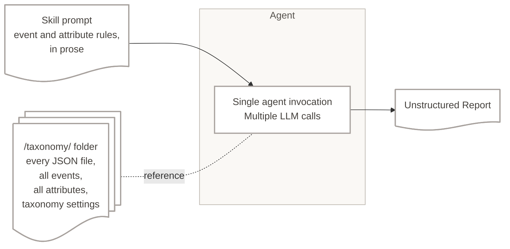

# Reviewing PRs at Agentic Speed

***Part 1: The Limits of the Brute-Force Prompt***

Agentic development has made it remarkably easy to ship new product features. Software engineers, who previously spent their time planning, writing and verifying their product, are now facing a barrage of code reviews, which become the bottleneck for rolling out new features.

At Houzz, I own our Product Event Taxonomy: the definition of the product events we collect to run experiments and improve the platform, spanning thousands of event names and attributes, across hundreds of screens and core platform entities. The taxonomy lives in GitHub as a set of JSON files, and every week I review dozens of changes to it, submitted as PRs (Pull Requests) by our engineers and analysts. In recent months, agents have been authoring an increasing share of them. As that volume grows, a review process that relies heavily on manual expert validation risks becoming a bottleneck, making it important for our governance model to evolve alongside agent-assisted development.

"If you can't beat them, join them!" I concluded, and jumped on the agentic bandwagon with my own automated PR reviews. This took a few funny turns, including a first version that spent 5-7 minutes and burned 650K tokens to clear a two-line change. Along the way I earned some takeaways, which I hope you will find meaningful. While my use case is the narrow domain of event taxonomy with JSON as source of truth, I believe the takeaways hold for almost any agentic code review pipeline.

In part 1 of this series, I will provide background to the problem of agentic PR review. In part 2, I will outline my working solution. In part 3, I will take a look at broader principles and ideas.

A note on the examples throughout this series: event names, attributes, file paths, thresholds and sample data are illustrative. They stand in as proxies for the real findings rather than reproducing Houzz's taxonomy, repository layout or internal configuration.

## Event Taxonomy as a PR Test Case

The Houzz Product Event Taxonomy consists of Events and Attributes, defined in JSON files. Each event makes reference to existing attributes.

The taxonomy goes through rigorous sanity checks as part of a build process, which generates event-firing functions for our engineers across several languages, event forwarding rules for our CDP, and data-warehouse ETL processing rules. In this sense, the taxonomy JSON files get compiled into software artifacts, in a similar fashion to how code is linted and compiled into executable software. Changes to the taxonomy have far-reaching impact on external code dependencies, event instrumentation, data pipelines and the eventual shape of our analytics reports.

Here is an example PR, adding a new event definition:

```diff
+    {
+        "event_name": "Create User",
+        "owners": ["jay@example.com"],
+        "implementation_notes": "Fire from the backend when the pro creates a user",
+        "attributes": [
+            "user_id",
+            "user_type",
+            "external_auth"
+        ]
+    },
```

The same PR adds two of the attributes the event references, and modifies a third which already exists:

```diff
 {
     "user_id": {
-        "type": "string",
+        "type": "int",
         "description": "User ID, primary key for the users table",
         "display_name": "User ID"
     },
+    "user_type": {
+        "type": "enum",
+        "description": "User account information at the time of creation",
+        "display_name": "User Type",
+        "values": [
+            "Visitor",
+            "Homeowner", 
+            "Professional"
+        ]
+    },
+    "external_auth": {
+        "type": "boolean",
+        "description": "Indicate the user's account is authenticated via 3rd party"
+    }
 }
```

When reviewing the `Create User` event, the taxonomy build process must look at all the Attributes defined in the system to verify the referenced attributes exist.

### What a PR Review Is Expected to Do
The changes above would easily pass the smoke check: all the fields are well defined, the attributes exist, and the build would generate its API bundles and other system artifacts. The smoke tests ensure the taxonomy "compiles", but they don't tell me whether to accept the change or not, which is where the PR review comes in, addressing three obligations:

#### 1. Assigning responsibility to the author

Consider that `jay@example.com` is not in the company directory, because they have left. If the PR author assigned them as the owner of the new `Create User` event, the review should block the change: a new event with no accountable owner is a governance problem from day one.

But suppose a different author submits a PR touching an unrelated event, and the checker notices `Create User` was orphaned months ago. Blocking that PR would punish an author for someone else's departure.

**In a general sense**, a repo of any age carries problems the current author did not introduce. The review must focus on their actions, not the repo's history.

#### 2. Holding the change against outside contracts

The change of `user_id`'s data type from `string` to `int` risks breaking ETL rules or degrading an API. The PR review must flag such changes as blockers.

**In a general sense**, a repo's internal consistency doesn't guarantee the change won't cause a regression elsewhere.

#### 3. Meeting the standards of the repo

The taxonomy adheres to naming conventions, an event data model and instrumentation best practices; straying from them will impact org-wide presentation as well as analytical capabilities. According to our event naming convention, `Create User` should have been named `User Created`. A PR review needs to hold changes against these standards early, because they are considerably harder to correct once the data has been collected.

**In a general sense**, every repo holds standards which are not covered by its build process: code efficiency, security principles, privacy by design, error handling conventions, accessibility, I18N.

---

There is one caveat which I'd rather mention than gloss over: a PR review is also expected to **verify the changes meet the requirements**. Unfortunately, this expectation is difficult to enforce under agentic development, where an agent submitting its own PR can fabricate its own requirements. My view is that this concern is better addressed in the agentic processing pipeline than in the PR process itself, so I will leave it aside here.


## Early Attempts at Agentic PR Checks

Let us turn back to the example event and attributes above. In spite of passing the smoke tests, the change introduces several problems:

- The `user_id` type was changed from **string to int**. This seemingly minor modification to an existing asset is the PR's riskiest change. While it's internally valid, and arguably more correct, the change will trickle down to APIs, configuration files and queries which may silently break.
- The event `Create User` doesn't follow our naming convention, as noted above; it should have been named `User Created`.
- The event's name is generic, whereas its implementation notes point to firing "when the **pro** creates a user".
- The event's owner name, `jay@example.com`, should be checked against the company directory.
- The description of the `user_type` attribute veers off the attribute's name, referring to time-specific account information.
- The `external_auth` attribute is a boolean, and needs to follow an "is_" or "has_" naming convention, such as `has_external_auth`.

My early attempt at creating an agentic PR review was a naive one: a skill with various test conditions written in prose, flagging the known problems. It tests everything in one pass, taking the skill prompt, observing the entire `/taxonomy` folder, and letting the agent and LLM figure it out in a single sweep.



The skill prompt itself looked like this:

```
# Purpose
Your objective is to inspect changes in this repo, then identify the 
changes to the JSON files under the `taxonomy` folder and report back issues.

# Methodology
Iterate through the definition files as outlined in the section below

## Events
For files that match `/taxonomy/events/*.json`, check that:
- "event_name" MUST follow the [Subject] [Action] naming convention, with the 
  action in past participle, written in Chicago-Style Capital Case
- Every address in the array value "owners" MUST appear in the
  node "employee_directory" in `/taxonomy/taxonomy_settings.json`
- "implementation_notes" MUST closely relate and explain the "event_name"

## Attributes
In `/taxonomy/attributes.json`, check that for each attribute:
- Attributes of type "boolean" MUST start with "is_" or "has_"
- Attribute description MUST elaborate on the attribute's purpose
- Attribute description MUST match the level of specificity of the attribute's key
- Data type of existing attributes may not change without validation against 
  external dependencies

# Report
Render each of the assets you found in the DIFF scan, and raise the issues you 
found for each in a list.

```

### Where the Naive Approach Broke

My early skill-based tests worked well. An initial scan validated event names, and so did the comparison of the concise event name against its underlying implementation purpose.

Soon however, problems showed up as I tried to add more test cases for attributes, or to reflect on data across different assets, such as matching owners against the company directory. Both precision and run time degraded rapidly, and a demand for stronger models became necessary. My hair was graying at an accelerated pace.

I observed several failure modes:

- **Context & Cost Flooding:** The repo's contents were too large for the LLM to consume as context. The JSON files in the `/taxonomy/` folder tokenize to ~650K tokens, becoming an expensive baseline for _any_ PR review, no matter how minor. The PR skill, running on GPT-5.3-Codex, took **5-7 minutes** to complete, while cheaper models such as GPT-5.1 mini failed entirely.
- **Instruction Overload:** Not all instructions cost the same. Asking the model to compare an event's name against its implementation notes is cheap and local. Asking it to iterate the full attribute list and resolve references against a separate corpus, such as matching every owner against the company directory, is a different order of work. My prose attempted all of it in a single run, and as I added more of the expensive kind, results grew inconsistent: rules were applied to the wrong asset types, and the directory, buried in a larger settings file, went unchecked.
- **Uncontrolled Agency & Instability:** The agent would stray out of the restricted folder, look for references elsewhere, and draw its own conclusions from unpredictable sources. The AI results varied depending on the agent and the model. Running locally with a desktop coding agent produced very different results than running a CI-based agent under GitHub's workflows, and the report's output format itself was inconsistent from run to run.

In the next post, I will walk you through the solution I built to address the Agentic PR Review: [Part 2, A Workable Pipeline Architecture](part2.md).
