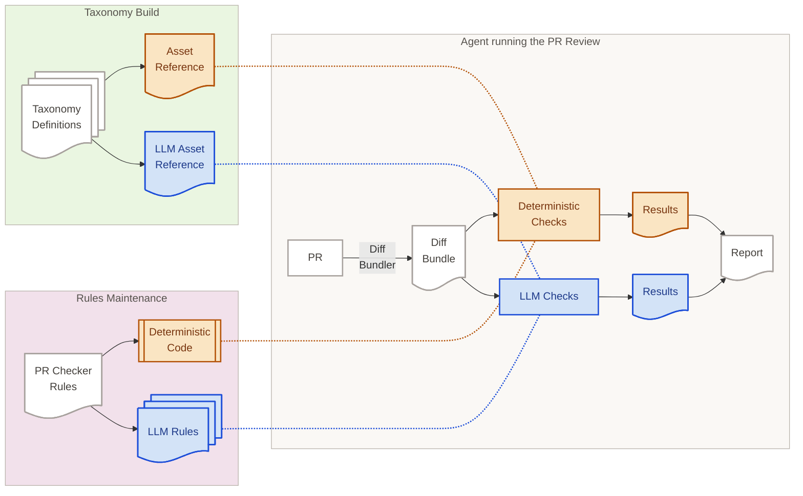

In [the previous blog post](), I outlined my initial steps at creating an AI-driven PR review for Houzz's Product Event Taxonomy repo. The brute-force approach was a single Skill of rules written in pure prose, which attempted to review changes to the repo while keeping the entire repo's content as context. This approach took a long compute time for the tiniest of changes, exhausted our token spend, and failed to deliver consistent results.

**As in part 1, the examples below are illustrative proxies rather than the repo's actual contents.**

Working on the problem, I landed on several decisions addressing what sat underneath the brute-force PR review: too much context, too many instructions in a single prompt, and an agent wandering through the repo to find its own answers, leading me to the following decisions:

**1. Cut what the agent reads.** Instead of pointing the agent at the repo, generate an **Asset Reference** during build time: a compact catalog of existing events, attributes and other assets, with a smaller version derived especially for the LLM so its context stays capped.

**2. Shape the diff.** A custom builder assembles a **Diff Bundle**, presenting each changed asset (event, attribute, etc.) as structured JSON with its before and after state, in place of Git's diff.

**3. Break the rules apart.** The large Skill prose becomes the **PR Checker Rules**: a catalog of individual rules in a single YAML file, each carrying a name, the asset types it applies to, a description in prose of what to look for, and the message it emits when it fires.

**4. Split mechanical rules from judgement rules.** Most rules never needed an LLM. Their prose is compiled into Python and runs deterministically. Only the judgement-based, semantic rules stay with the LLM.

**5. Leave the skill nothing to decide.** The skill builds the Diff Bundle, runs both deterministic and LLM checks, and merges their results into a single report. An orchestrator, rather than a reviewer.

I will go through examples of applying these decisions in the takeaways later in this post. For now, here is how the pieces fit together.

## A Framework for Managing PR Reviews

The result is a framework with three separate lifecycles: the taxonomy build, which generates the references; Rules Maintenance, where rules are added, evaluated and deployed; and the PR check itself.



(*) Dotted lines show which reference resource is read by each check during review time.

The taxonomy build runs on every change to the definitions, so the references are generated there and committed alongside everything else.

Rules Maintenance happens whenever I add or modify a rule. The change is made to the PR Checker Rules; the agent then either compiles it into deterministic Python or folds it into the LLM-facing instructions for its asset type. Both outputs are committed to the repo, so nothing is generated at review time.

During a PR, the review skill builds the Diff Bundle using a dedicated Python script, runs it through the deterministic checks and the LLM checks, and formats the merged results for the author. It consults the Asset Reference where a rule calls for it, but never loads more than the rule asks, so the running context stays shallow.

As the framework grew I added maintenance skills: tools that analyze issues I catch by hand in manual PR audits, draft the prose for new rules, adjust the Diff Bundle or the Asset Reference when a rule needs an extra field, and keep regression tests for the checker itself.

## Architecture Outcomes

Running the new PR checker pipeline against the same PRs and the same repo improved on every axis I was measuring:

- **Speed:** PR runtime dropped from 5-7 minutes to ~30s for a full PR.
- **Costs:** The agentic part of the skill is given a narrow Diff Bundle (10K tokens), and the LLM version of the Asset Reference (2K tokens). This small volume allows me to run the skill on simpler models.
- **Control:** The agent no longer hunts for its own references. It reads the compact set it is handed and stays within it, instead of wandering off into the repo.
- **Report Precision:** Both deterministic and LLM-based evals emit their findings in a fixed JSON schema, which lets me aggregate and format the final report, and add deterministic PR approval gates on top of it.
- **Test Coverage Scale:** The PR Checker Rules have grown from the initial ~30 tests to over 80 tests spanning different asset types and their rules, without deteriorating speed or precision.

## Takeaways for Performant and Precise PR Review

### Takeaway 1: Shape the Diff

The default Git "diff" only shows a few lines above and below the affected changes. As a reviewer, I constantly need to expand the boundaries to fully contextualize the change. LLMs working on a Git diff need to do the same, with unpredictable patterns running at a cost of multiple iterations.

Consider the following change to the attribute `"user_type"`, as conveyed in a Git diff:

```diff
@@ -6384,7 +6384,9 @@
            "Visitor",
            "Homeowner",
-           "Professional"
+           "Professional",
+           "Inspector"
        ]
    },
```

Notice there's no attribute name, no type, no description. The added value, "Inspector", is completely out of context. Compare this to the same change as a Diff Bundle:

```json
{
  "attribute": "user_type",
  "before": {
    "type": "enum",
    "values": ["Visitor", "Homeowner", "Professional"],
    "description": "User account information at the time of creation"
  },
  "after": {
    "type": "enum",
    "values": ["Visitor", "Homeowner", "Professional", "Inspector"],
    "description": "User account information at the time of creation"
  }
}
```

Conveying the PR changes using a Diff Bundle simplifies the work for the agent. This approach holds for any repo, not just for JSON blobs. Here are a few ideas about describing your PR diff as a bundle:

* For code changes, extract the entire affected function or class
* For visual asset changes, extract a rectangle that isolates the change
* For configuration changes, extract an entire JSON/YAML container
* For contract changes (API, service, schema), extract the entire call descriptor

### Takeaway 2: Don't Throw the Kitchen Sink at the LLM

If you point the agent at the whole repo, it may as well read the ***whole repo***: code, comments, specs, test cases, binary assets and stale history that no longer describes anything. Throw in the complete works of Shakespeare while you're at it.

LLM evaluations are efficient and less likely to fail when given a concise catalog of assets, reducing the context bloat.

For example, asking the agent to `"check if the new event name follows the [Subject] [Action] pattern"` requires the agent to tell what "Subjects" are. In our system, the subjects are a list of our **core entities** - "User", "Project", "Timeline", "Lead" etc. Given that, the event names `"Project Started"`, `"Project Shared with Customer"` and `"Lead Added to Timeline"` are valid, but `"Project Calendar Appointment Scheduled"` is not. By providing a curated list to the agent, the LLM was quick to judge the inputs; this wouldn't have worked if the list was buried somewhere in an arbitrary folder within the repo, or if the prompt asked the agent to iterate - on-the-fly - through the existing events and derive its own perceived "correct" core entity names.

A more complex LLM task is asking `"check if a new event name conflicts with any existing event name"`. Sending the agent to seek through the entire repo would either force it to load hundreds of thousands of tokens, or go grep-ing around with similar nouns and verbs, trying to find similarities. A simpler approach is to give the agent a curated list of the existing event names.

Our Asset Reference looks something like this:
```json
{
    "events": [
      "Lead Added to Timeline",
      "Project Started",
      "Project Shared with Customer",
      "User Account Created",
      ...
    ],
    "core_entities": [
      "Lead",
      "Project",
      "Timeline",
      "User",
      ...
    ],
    "employee_directory": [
      "john.doe@example.com",
      "jane.doe@example.com",
      ...
    ]
}
```
For your own repo, consider:
* Create an Asset Reference for each of your asset types: classes and their purposes and contracts, APIs and their surfaces, core UI components, and the reference lists your rules check against, such as approved values, valid owners, or deprecated symbols. Present each with its file location, and strive for a consistent shape across the asset types.
* PR check is not the appropriate time for the LLM to **crawl across other repos** for information. If it's necessary for the PR to check across repos, ensure each repo provides an MCP, an MD file or a bundle to convey its integration surfaces (APIs, services, library classes), allowing the agent to load it only when needed.

### Takeaway 3: Build a Catalog of Rules

The brute-force approach used a long list of tests, written as prose inside a Skill. At runtime, it meant that every review carried every rule: an eval judging a new attribute also included the rules prompt for handling events, screens and other assets, which did not apply to the current asset, and at times conflicted with other rules. Breaking the prose into individual rules let me scope each rule to its corresponding assets, and evals became faster and less likely to fail once their instructions were narrow.

Each rule in the example below has a name, the asset types it applies to, a severity, a description in prose of what to look for, and the message it emits when it fires. Notice that `owner_directory_check` specifies a `deterministic` handler, while `attribute_description_mismatch` uses `ai`.

```yaml
checks:
  - id: owner_directory_check
    handler: deterministic
    asset_type: event
    severity: IMPORTANT
    field: owners
    implementation: |
      For each event in the diff, look up every entry in its "owners" field
      against the "employee_directory" list in the Asset Reference. Emit one
      finding per entry that is absent from the directory.
      Tokens: {name} = event name, {owner_field} = the owner field that failed,
      {email} = the unmatched address.
    finding: |
      "{name}.{owner_field}: owner {email} not found in the company directory,
      update to a current owner."
  - id: attribute_description_mismatch
    handler: ai
    asset_type: attribute
    severity: IMPORTANT
    field: description
    trigger: |
      The attribute name is generic (no product, feature, or domain qualifier)
      but the description reveals that the attribute is specific to a single
      feature, flow, or product context. Flag when the description mentions a
      specific feature name, flow name, product area, or user action that is absent
      from the attribute name itself, and the name would be misleading if reused
      in a different context.
    finding: |
      "{name}.description: attribute name is generic but description is
      context-specific; consider adding a domain qualifier to the name, or
      confirm this attribute is intentionally reusable (found: \"{description}\")."
```

The PR Checker Rules are not the final artifact; they are only a source of truth. In my current implementation of the PR checker, I decided to group together the LLM-facing rules by asset type, which fits how the evaluation reads both prompt and changes - one asset type at a time. Because the rules stay separate in the origin form, I can revisit or tweak how they are applied as needed.

For your own repo, consider:
* Distinguish your repo's asset types: code, configuration, docs, specs, CSS and images each carry their own rules, and the tests for one rarely apply to another. State the asset on each rule, and keep the rules separate when they run.
* Structure your tests as prose and make each test autonomous. Grouping the tests together, running them serially or in parallel should be a decision you can alter later.

### Takeaway 4: Push for Deterministic Checks

It's easy and tempting to prompt agents to do large-scale analysis across unfamiliar repos, which can be very useful for a Dev Ops team when debugging a production issue with unfamiliar code. But this approach comes at a cost which doesn't scale for recurring PR checks.

Instead, use the LLM to write code that performs the **deterministic** test, rather than evaluating the test on demand. By moving soft judgement-based evaluation to deterministic tests, you implement the mechanics once, and they stop costing tokens on every review.

In [Part 1]() I gave an example of validating an event's owners against the company directory. Performing this evaluation using LLM will take precious time, while doing so in code takes a fraction of a second. The `owner_directory_check` in the YAML above is a deterministic check; I use the agent to take the test prompt (`"For each event in the diff...."`) and convert it into a Python script.

The same approach can handle much harder cases. For example, consider the following change:

```diff
{
     "currency": {
         "display_name": "Currency",
         "type": "enum",
         "values": ["USD", "CAD", "EUR", "NZD", "GBP"],
     },
+    "invoice_currency": {
+        "display_name": "Invoice Currency",
+        "type": "enum",
+        "values": ["USD", "CAD", "GBP"],
+    },
}
```

Normally, during manual PR review, I'd flag the new attribute as an oversight: we strongly encourage our users to re-use existing attributes over defining new ones, or - if a new derivative attribute is necessary - define it as **inherited** from the originating one.

```diff
+    "invoice_currency": {
+        "display_name": "Invoice Currency",
+        "type": "inherited",                    // "inherited" data type
+        "reference_attribute_id": "currency"    // inherit the enum values from this attribute
+    },
```

My manual PR review "strong encouragement" could read like a judgement call, which seems best suited for LLM. However, if you consider the heavy lifting the LLM will have to do, you realize that in order to find an existing attribute whose values match the new attribute's values, it will have to iterate through all attributes, effectively loading them all into the context.

This is why I argue for handling the comparison deterministically rather than asking the model to infer it. For illustration, consider a configurable overlap threshold of 60%, describing the task to the agent as follows: "Flag a newly introduced ENUM attribute when at least 60% of its values also appear in another ENUM attribute with a broader value set. Suggest using the broader attribute or applying attribute inheritance." The 60% threshold is illustrative rather than a production value; in practice, teams should calibrate the threshold using their own taxonomy, false-positive tolerance, and governance requirements.

The "inherited attribute" test case is more complex than the "needle in the haystack" first example, and a similarity threshold is admittedly a blunter instrument than an LLM's judgement. But bluntness is not inaccuracy: the check flags the right attributes for the purpose of a PR review, and it does so identically every time. My argument here is that many "eval" judgements can be moved to "deterministic", and that doing so relocates the cost of the LLM from every review run to a single up-front code generation.

For your own repo, consider the following deterministic checks:

* Flag functions that exceed length or depth of nesting
* Flag circular dependencies between classes - this kind of graph mapping is hard to code manually, but trivial to generate with LLM.
* Flag regressions and changes in public-facing contracts - SDKs, APIs, GQL handlers and Services

---

### Where This Leaves Us

In this post I went through the PR Review framework that I landed on, to address the concerns of speed, costs, control, precision and coverage. Takeaways 1-3 optimized the prompt and context fed into the LLM. Takeaway 4 built on the work of the previous three, and moved LLM-based evals to deterministic checks, the single largest runtime gain in this project.

In the next post I'll discuss what agentic development does to the repo owner's job: [Part 3, Governance, Authority, and Institutional Knowledge]().
