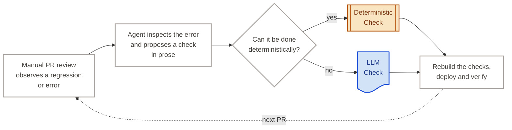
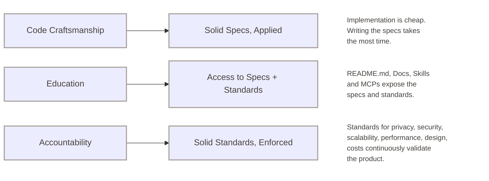

In [the previous blog post](), I concluded four takeaways that help improve the scale and precision of PR tests:
1. Shape the Diff
2. Don't Throw the Kitchen Sink at the LLM
3. Build a Catalog of Rules
4. Push for Deterministic Checks

Those four are about mechanics: how to make the checker fast, cheap and precise. This post is about the broader changes agentic development brings. As in part 1, the examples below are illustrative proxies rather than the repo's actual contents.

## Rethinking the Repo Owner's Job

I have been manually reviewing PRs to the Houzz Product Event Taxonomy repo over several years. Some PRs pointed to gaps in the taxonomy's specs, such as unclear naming conventions or the promotion of attribute inheritance. In other cases, additional reference data was needed, such as the company directory or core entity names. Some PRs made me reflect on my early design decisions, such as naming events as affirmative, evergreen facts and business outcomes ("User Created", "Contract Signed"), as opposed to ephemeral, negative or ambiguous notes (e.g. "Email Subscription Toggled", "Signup Failed").

I felt I owed my engineering and analytics teams the clear rules of the taxonomy, as well as the underlying reasons for my choices. The taxonomy's internal Wiki grew to over 120 articles, discussing our data model, nomenclature, naming rules, definition files and more. In my PR reviews I would often quote from a large and ever-growing Wiki page, "Common PR Pitfalls", probably the least-read document ever, or at least, that's how it felt.

Working on an agentic PR review came in response to agents quickening our product lifecycle. Through the process, I came to rethink my place and responsibilities as the repo owner; from thinking about the mechanics of checking PRs for acceptance, I moved to reflecting on the scale, purpose and context of the review itself.

## Broader Takeaways for Agentic PR Review

### Takeaway 5: Always Keep Improving

I was lucky to have had a big backlog of pet peeves to kick-start the initial PR test cases. The "Common PR Pitfalls" yielded some good 30+ tests, which were soon deployed and run as a GitHub action.

I was hoping the agentic PR review could be used for auto-approvals, but was soon proven wrong. I kept doing manual PR reviews to inspect the quality of the agentic one, and they surfaced nuanced issues, which were less common but still posed high risk. There appear to have been more peeves than those I'd care to pet, and within 4 months the rule catalog grew to 80+ cases. In growing the catalog, I realized my job is no longer only about rejecting bad PRs; it's now centered on improving the **PR Checker Rules**.

There is no end to this. Users will always find new and creative ways of using your product, and whenever I add new functionality to the repo, new PR checks are necessary, with critical failures always surfacing later. False positives occur too, such as approved exceptions to the naming convention, or pre-existing issues flagged against an author who did not introduce them. The maintenance work for the framework calls for an organized workflow, rather than one-off fixes.

What worked for me is setting up a closed loop, backed by an agentic skill: every manual review feeds the checker that is meant to replace it. Whenever I observe a regression or error during manual PR review, I work with the agent to verbalize "what's wrong with this change", describe that in prose, define a test to flag it, deploy it and test that it correctly flags the current issue. The next PR is then reviewed against a checker that is one rule better than the one before it. Maintenance is not limited to the checks themselves: adjustments to the **Asset Reference** and the **Diff Bundle** may also be necessary, as well as moving slow LLM evals to deterministic checks. None of this is trivial: adding new PR review checks can take several hours of iterative work, optimizing for performance, tuning against [overfitting](https://en.wikipedia.org/wiki/Overfitting) and creating a test suite. The returns are confidence and consistency going forward.



<div class="takeaway" markdown="1">

Can you imagine how this applies to your own use cases? Consider:
* What are your typical PR review observations? What are your pet peeves that trigger you? Can you rationalize them and put them into prose?
* How much of the trigger prose can be put into deterministic code, if writing code was not a concern?
* What will it take for you to have a framework to expedite writing new PR checks? Can a Skill help you define new checks, compile them to code, and evaluate their performance against the offending PR?

</div>

### Takeaway 6: Write Actionable Reviews

Whenever a PR failed my manual inspection, my first reaction was a scream of frustration: *"why didn't they read instruction #3 in section 3.5.1 of the naming convention for float-type attributes?"* Once the rage subsided, and in some cases before it did, I would write a half-baked suggestion to the well-meaning author, and then edit it to tone down the expletives. Or, if the situation seemed hopeless, I would ask them to see me after class. That is, to attend the office hour.

Half-baked comments and office hours do not survive the pace of agentic development. A rejection has to articulate how to do things the *right way*, in the finding itself. Stopping the agent with partial explanations only sends it looking for creative ways around the obstacle.

It is up to us, the repo owners, to find, articulate and then uphold the *right way*. In the PR Checker Rules I make sure every test case incorporates a user-facing (or agent-facing) response: simple errors get a statement of what went wrong and how to fix it. Big-picture misunderstandings about the platform get a reference to the relevant Wiki articles, spec documents and MCP tools; ideally those references are themselves written to be agent-facing.

Taking the example PR from part 1 of this series, a PR checker report should read something like this:

```
/taxonomy/events/users.json -> Create User
  * [IMPORTANT] event.name: event name should follow [Subject] [Action] with a
           past-participle action; use "User Created". For more information consult
           /docs/event_naming_convention.md
  * [IMPORTANT] event.owners: "jay@example.com" not found in the company
           directory, update to a current owner.

/taxonomy/attributes.json -> user_id
  * [BLOCKER] attribute.type: changing an existing attribute's type from "string" to
           "int" breaks downstream API, ETL and report consumers; this change
           requires sign-off from engineering and analyst leads.

/taxonomy/attributes.json -> external_auth
  * [NIT] attribute.name: boolean attribute should use an "is_" or "has_"
           prefix; use "has_external_auth". For more information consult
           /docs/attribute_naming_convention.md
```

<div class="takeaway" markdown="1">

For your own repos, consider:
* Audit your own review comments (or PR bot findings): how many name the problem only, versus naming the problem and offering the fix?
* When you flag something, could the author act on your comment alone, or would they still need to ask you a follow-up question? If the latter, consider there are knowledge gaps that need addressing.

</div>

### Takeaway 7: Turn Personal Knowledge into Institutional Knowledge

If the checker is doing the work, what am I still doing here? Three things used to motivate my PR review: my code craftsmanship, educating my fellow teammates, and keeping accountability in check. In reality, though, craftsmanship diverges across authors, teammates rotate, and accountability degrades when people forget to ask the right person at the right time. Once PRs are authored by agents, craftsmanship becomes moot, there is no one left to educate, and accountability is anyone's guess.

I'm not arguing that craftsmanship, education and accountability stopped mattering; my point is that agentic code has shifted my motivation towards defining, exposing and enforcing the repo's specs and standards:



In the Product Event Taxonomy repo:
* The **Specs** of the taxonomy are reflected in the PR checker's tests: events must follow the `[Subject] [Action]` pattern, boolean attributes must start with either `has_` or `is_`.
* The **Standards** of the taxonomy call for readability and presentation in US English. If someone changes the specs to use Hungarian notation for attributes, or French spelling for events, the change should be flagged.
* **Access** to specs and standards in the taxonomy repo is provided through folder-specific READMEs, Wiki, and most notably in a designated MCP, which can answer basic questions such as `is the event name "Create User" ok?`, or `is there an existing attribute for user status?`; the MCP's responses include relevant directives from the specs, per the relevant asset type, to assist the agent with follow-up work.

Manual PR reviews are the place where you can spot the repo failing to define its specs, communicate them, or enforce its standards. The solution is to continuously **Turn Personal Knowledge into Institutional Knowledge**. Do that, and you will empower your agentic co-authors, and earn the ability to walk away from the project safely: the standards you hold don't leave when you do.

<div class="takeaway" markdown="1">

Can you think of turning personal knowledge to institutional knowledge? Consider:
* Is there a library or custom code which you use for testing, which nobody else knows about?
* Are there hidden assets in your repo which you know could be useful sometime in the future?
* Is your code developed from specs? Are the specs up-to-date? Are they complete? Can they be used to evaluate code changes?
* Does your repo follow standards for product lifecycle, coding, visual design, accessibility, deployment, testing, scalability, I18n, security, privacy, costs? Can they be used to evaluate the project's specs?

</div>

### Takeaway 8: Passing Quality Isn't the Same as Having Authority

Some of you at this point may have noticed a question I've been dodging throughout this series. I've walked through the PR framework, addressing performance, coverage, precision, maintenance and institutional knowledge, all in the hope of eventually removing myself from the loop. Supposedly, if an agentic review passes our checks cleanly, the agent should approve and merge the PR. Have we truly scaled our engineering velocity?

Consider, for a moment, that an agent authored and submitted a PR with zero critical regressions for any of the examples below. Should the PR be merged without a manual review?

* A change to a shared protocol, schema, or public interface
* Adding a new library dependency
* A change touching PII or user-data handling
* Changes to sensitive platform activity, such as authentication, authorization, payment or billing logic.

The answer is, unfortunately, no. The examples above may raise serious legal, compliance and security concerns, and evaluating changes for correctness is not the same as what is really needed: a separate criterion for merging, **Demanding Human Authority**.

This concern is not novel, and is already established and addressed:

- GitHub's [Required Reviewer Rule](https://github.blog/changelog/2026-02-17-required-reviewer-rule-is-now-generally-available/) and CODEOWNERS let specific paths (`package.json`, `requirements.txt`, `.github/workflows/`) demand a specific team's sign-off, unconditionally, no matter what the automated review says.

- [SLSA](https://slsa.dev/)'s [Source Track](https://slsa.dev/spec/v1.2/source-requirements) calls for the same thing under the name "two-party review" for supply-chain-security control.

- [SOC 2](https://www.aicpa-cima.com/topic/audit-assurance/audit-and-assurance-greater-than-soc-2) and [SOX](https://www.sec.gov/about/laws/soa2002.pdf)-style audits check for exactly this: separation of duties, whether one person can write and approve their own change to a sensitive system.

I considered three heuristics for deciding which PRs may merge automatically:
1. **Trusted Authors** - limit auto-merge to PRs created by the org's most trusted authors. This may sound appealing, but I advise against it: it doesn't address the velocity concern for the rest of your contributors, and it sets no blocks against a compromised rogue agent.
2. **Denylist** - mark sensitive folders and files, either through a config file or inline within the file contents, as requiring human review. This approach depends heavily on keeping close tabs on new files, and is therefore prone to errors and oversights.
3. **Allowlist** - my preferred approach, which denies approval by default. Only specific, low-friction or reversible changes may merge automatically. In the taxonomy repo, changes to an attribute or event description, updating ownership, or extending a list of ENUMs would be good candidates to auto-merge once basic checks pass.

For my part, nothing merges in my repo without my explicit approval, as I evaluate the three heuristics above going forward. Months into running the checker, the nuanced findings still surface often enough that I am not ready to hand over the final call. My preference is to err towards control and granularity, with the intent of gradually allowing auto-approval as test coverage and the PR maintenance loop mature.

<div class="takeaway" markdown="1">

For your own repos, consider:
* Which categories of change in your repo should never be auto-merged, no matter how clean the diff looks?
* Can you annotate files, classes and functions to make sure an agent never lets them slip through PR without human approval?
* Is that rule enforced structurally (CODEOWNERS, required reviewers, a hard gate), or does it currently rely on someone remembering to ask?
* Can you think of trivial changes that should be auto-merged once they pass? Consider formatting changes, typo fixes in comments, new unit test cases, version bumps and I18n translation files.

</div>

## Summary

Agentic development accelerated code production but introduced its own brand of problems. This blog series elaborates on my findings, as I tried to use agents to handle the velocity and agency. Here is what I observed as key to getting agentic PR review to work:

1. **Shape the Diff** ([Part 2]()) - give the reviewer the whole asset, not a few lines of context.
2. **Don't Throw the Kitchen Sink at the LLM** ([Part 2]()) - don't point the agent at the repo, cap the context with curated assets.
3. **Build a Catalog of Rules** ([Part 2]()) - scope each rule to the assets it applies to, instead of one long prose ruleset.
4. **Push for Deterministic Checks** ([Part 2]()) - use LLMs to write fixed tests, not to run them.
5. **Always Keep Improving** - the point of a manual review becomes improving the checker.
6. **Write Actionable Reviews** - name the problem and the fix, for humans and agents alike.
7. **Turn Personal Knowledge into Institutional Knowledge** - formalize what only lives in your head.
8. **Passing Quality Isn't the Same as Having Authority** - some changes demand a human review, regardless of how clean they are.

Come to think of it, many software engineers struggle with hard-to-read diffs, content scattered across files and folders, accountability that erodes over time, standards arriving in hindsight, and personal knowledge that quietly disappears. None of this is new. Agentic development simply put the spotlight on it.

Our job as repo owners has changed, and it may change again as the next tech revolution unfolds. But until then, everyone who owns a repo will have to close the gaps I described, as speed and agency outrun our governance. Better to meet them with a framework than to hold off for an office hour.
